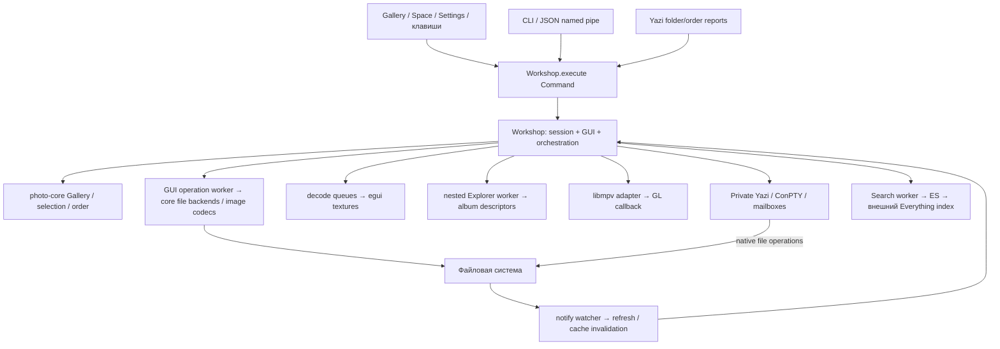

# Afiocira — архитектурное ревью Азу́роса Клаудапи

## Подтверждённые замечания

### 1. [P1] Снятый в Gallery файл остаётся выбранным в Yazi, если он находится в другой подпапке

**Место:** [yazi.rs:62](<../../crates/photo-gui/src/yazi.rs#L62>), [navigator.rs:35](<../../crates/photo-gui/src/navigator.rs#L35>).

**Триггер и последствия.** В обзоре альбомов отметить файлы из двух подпапок, затем снять отметку одного из них. Gallery передаёт новый полный набор, но Lua `apply()` очищает отметки только в каталоге курсора через `toggle_all off`, после чего лишь добавляет переданные пути. Ранее отмеченный файл из другой подпапки остаётся в глобальном выборе Yazi. Передача фокуса этого не исправляет. Последующие native операции Yazi могут включить файл, который пользователь уже исключил из выбора; стандартные `d`/`D` относятся именно к выбранным файлам ([keymap.toml:76](<../../assets/yazi-defaults/keymap.toml#L76>)). Удаление в ходе проверки не запускалось.

**Доказательство.** В изолированной native сессии загружены `albumA/one.png` и `albumB/one.png`. После первого `set_marked` оба пути подтверждены отдельным snapshot самого Yazi. После второго `set_marked` Gallery содержит только A, а Yazi — A и B. После `focus_navigator` Yazi по-прежнему содержит оба. Между командами выдержаны паузы, чтобы исключить coalescing из следующего замечания. Результат: [native-4e593c8d/results.json](<../../target/azuros-review/native-4e593c8d/results.json>); сценарий: [check_nested_marks.py](<../../target/azuros-review/check_nested_marks.py>).

**Минимальное исправление.** Явно определить область отметок, которыми владеет Gallery: например, загруженные пути плюс ранее переданные отметки. При замене снимать отсутствующие в новом наборе отметки в этой области, сохраняя чужой выбор Yazi за её пределами. Один `toggle_all` в каталоге курсора не описывает область обзора альбомов.

**Регрессия.** Два альбома и третья независимая папка: отметить A+B в Gallery и внешний C в Yazi; снять B; проверить фактический выбор Yazi до и после обоих переходов фокуса: A+C, без B. Тот же случай проверить для полного Escape-clear.

### 2. [P2] Coalescing mailbox может заменить ещё не применённые отметки командой `preserve`

**Место:** [yazi.rs:663](<../../crates/photo-gui/src/yazi.rs#L663>), [navigator.rs:37](<../../crates/photo-gui/src/navigator.rs#L37>), [navigator.rs:176](<../../crates/photo-gui/src/navigator.rs#L176>).

**Триггер и последствия.** Потребитель Yazi задерживается, `poll_mark_sync()` публикует `replace` и сразу сбрасывает `selection_dirty`. Последующий переход в Yazi отправляет только курсор с `preserve`. Обе команды используют один `folder.txt.request-apply`; Windows rename заменяет непрочитанный файл. Полный набор отметок теряется без ошибки. Обратный переход импортирует пустой выбор и в Gallery.

**Доказательство.** Приостановлен исключительно дочерний Yazi собственного fixture, чтобы детерминированно задержать чтение. После `set_marked(a,b)` и 350 мс mailbox содержит `replace,a,b`; после `focus_navigator` — только `preserve`. После возобновления и обратного перехода `marked_paths=[]`. JSON до/после: [native-d4f65caf/results.json](<../../target/azuros-review/native-d4f65caf/results.json>), сценарий `mailbox_marks()` в [check_native.py](<../../target/azuros-review/check_native.py>). Приостановка моделирует задержку потребителя; это не утверждение о частоте такого расписания на обычном компьютере.

**Минимальное исправление.** Разделить состояния «опубликовано» и «применено». До подтверждения последовательности не разрешать cursor-only запросу вытеснить неподтверждённый полный набор: объединять его с ожидаемыми отметками либо сохранять операции в порядке. Atomic rename обеспечивает целостность файла, а не доставку мутации. Nein, переименование файла ещё не является подтверждением выполнения команды.

**Регрессия.** Заблокировать потребление, отправить replace → cursor-only → возобновить; подтвердить cursor и точный набор отметок у Yazi. Добавить replace → replace и сценарий возврата фокуса до подтверждения.

### 3. [P2] После timeout новый переход фокуса принимает запоздавший старый snapshot

**Место:** [yazi.rs:528](<../../crates/photo-gui/src/yazi.rs#L528>), [yazi.rs:557](<../../crates/photo-gui/src/yazi.rs#L557>), [navigator.rs:68](<../../crates/photo-gui/src/navigator.rs#L68>).

**Триггер и последствия.** Snapshot не успевает за секунду. `navigator_snapshot()` возвращает ошибку, но оставляет `pending_snapshot`. Запоздавший ответ появляется, после чего пользователь меняет курсор Yazi. Следующий `request_snapshot()` повторно использует тот же путь; `poll_snapshot()` немедленно читает уже существующий старый файл. Gallery открывается на прежнем файле или прежнем выборе, хотя команда успешно завершилась. Кроме того, сама секундная задержка занимает UI thread — обработка PTY внутри цикла не обрабатывает обычный GUI ввод и отрисовку.

**Доказательство.** Собственный Yazi приостановлен на время первого запроса, получен `Yazi selection timed out`, затем возобновлён. Сохранён его запоздавший ответ с `a.png`. После перехода самого Yazi на `b.png` независимый private snapshot подтвердил `b.png`. Следующий `focus_gallery` за 16 мс установил курсор Gallery на `a.png`. Оба исходных ответа и итог: [native-01c34095/results.json](<../../target/azuros-review/native-01c34095/results.json>), [check_stale.py](<../../target/azuros-review/check_stale.py>).

**Минимальное исправление.** Отделить один логический запрос от его повторных попыток. После timeout отменять его ID; новый переход должен иметь новый ID и путь ответа. Проверять соответствие ответа текущему запросу. Вынести ожидание перехода в уже используемую приложением модель pending/phase, чтобы deadline не удерживал UI thread.

**Регрессия.** Timeout запроса N → поздний ответ N → изменение курсора/отметок → запрос N+1. Старый ответ должен игнорироваться, а UI оставаться обслуживаемым до свежего ответа или явной ошибки.

### 4. [P2] Два открытых экземпляра последовательно стирают сохранённые shortcuts друг друга

**Место:** [shortcuts.rs:336](<../../crates/photo-gui/src/shortcuts.rs#L336>), [shortcuts.rs:344](<../../crates/photo-gui/src/shortcuts.rs#L344>), [settings.rs:141](<../../crates/photo-gui/src/settings.rs#L141>). Аналогичная передача целого устаревшего Yazi profile находится в [yazi_profile.rs:71](<../../crates/photo-gui/src/yazi_profile.rs#L71>); native воспроизведение ниже относится к shortcuts.

**Триггер и последствия.** Открыть два экземпляра с общим settings home. В первом назначить `rotate_left=J`, затем во втором — `rotate_right=L`. Второй планирует изменение от своей загруженной при старте копии и сохраняет весь объект `shortcuts`. Чтение свежего JSON внутри `save_property()` сохраняет соседние верхние поля, но не спасает перезаписываемый объект. Первая успешно сохранённая настройка молча исчезает. Для этого не нужна одновременная запись или редкая гонка.

**Доказательство.** Два native GUI, разные API names, один synthetic settings home: после первого сохранения файл содержит `space.rotate_left=J`; после второго — только `space.rotate_right=L`. Оба API вызова завершились успешно. [native-d4f65caf/results.json](<../../target/azuros-review/native-d4f65caf/results.json>), функция `concurrent_settings()` в [check_native.py](<../../target/azuros-review/check_native.py>).

**Минимальное исправление.** Проводить изменение конкретного поля/действия поверх свежего документа под межпроцессной блокировкой либо применять compare-and-swap с ревизией и явным конфликтом. Обновлять локальную копию полученным результатом. Одна блокировка вокруг нынешней записи целого stale объекта проблему последовательных сохранений не исправит.

**Регрессия.** Два заранее открытых экземпляра, последовательные изменения разных actions и разных Yazi fields, затем перезапуск: оба изменения сохранены. Отдельно проверить одновременные записи разных верхних полей и явный конфликт одного поля.

### 5. [P2] Внешняя атомарная замена файла сохраняет старый preview до F5

**Место:** [file_state.rs:135](<../../crates/photo-gui/src/file_state.rs#L135>), [file_state.rs:146](<../../crates/photo-gui/src/file_state.rs#L146>), [image_cache.rs:14](<../../crates/photo-gui/src/image_cache.rs#L14>).

**Триггер и последствия.** Открытый файл заменяется через temp + rename/replace, как при сохранении во внешнем редакторе. Watcher считает create/remove/name membership-событиями без изменения пикселей. Если путь сохранился, пересканирование не меняет список, а path-based cache остаётся валидным. Пользователь продолжает видеть прежнее изображение, хотя операции с файлом уже читают новое содержимое.

**Доказательство.** Дождался preview `a.png`, сохранил его texture ID `14`. Другой PNG подготовлен вне наблюдаемой папки и перемещён `os.replace` на `a.png`; изменение байтов проверено. Через две секунды ID остаётся `14`, после API `refresh` становится `16`. Это не только совпадение имён: [image_cache.rs:61](<../../crates/photo-gui/src/image_cache.rs#L61>) создаёт новую текстуру при decode, а этот cache не обновляет её пиксели на месте. [native-5f2c55a0/results.json](<../../target/azuros-review/native-5f2c55a0/results.json>), [check_replaced_pixels.py](<../../target/azuros-review/check_replaced_pixels.py>).

**Минимальное исправление.** Считать rename/create на уже известный путь возможной заменой содержимого: инвалидировать его thumbnail/preview и старые decode results. Для сохранения кэша после чистого переименования сравнивать identity/version, а не только путь. Перечитывать все изображения папки не требуется.

**Регрессия.** Прогретые thumbnail и preview, затем замена другим PNG с тем же именем из другой папки. Без F5 должен появиться новый decode/texture; остальные текстуры должны сохраниться.

### 6. [P2] Settings Apply всё ещё зависит от DDS при восстановлении runtime preferences

**Место:** [yazi_settings.rs:665](<../../crates/photo-gui/src/yazi_settings.rs#L665>), [yazi.rs:310](<../../crates/photo-gui/src/yazi.rs#L310>).

**Триггер и последствия.** Runtime sort/hidden/linemode отличается от стартового TOML, а `ya emit-to` недоступен, зависает или возвращает ошибку. Candidate восстанавливает эти параметры через `pane.emit()`, которое использует private mailbox только для `app:theme`; остальные команды идут в DDS worker. Candidate не достигает ожидаемого snapshot и через 12 секунд откатывает применение несвязанной настройки. Private focus при этом работает. В [yazi_settings.rs:609](<../../crates/photo-gui/src/yazi_settings.rs#L609>) ошибки helper самого candidate не извлекаются, поэтому остаётся общий timeout вместо раннего точного сообщения.

**Доказательство.** Создана отдельная копия GUI/Yazi в `target`; только в ней `ya.exe` заменён stub, возвращающим exit 9. Действия по остановке или перенастройке общего DDS listener не выполнялись. Через private emit runtime sort изменён с alphabetical на natural, что подтверждено snapshot. `focus_gallery` работает. Применение `scrolloff=5` завершается ошибкой `Replacement Yazi could not verify its configuration/context` за 12.156 с; прежний config сохранён. [native-04954f51/results.json](<../../target/azuros-review/native-04954f51/results.json>), [check_dds.py](<../../target/azuros-review/check_dds.py>), [unavailable_ya.rs](<../../target/azuros-review/unavailable_ya.rs>). Это проверка недоступности helper, а не повторное создание неисправного общего Windows listener.

**Минимальное исправление.** Перенести восстановление preferences в тот же адресованный private протокол, передавая позиционные и именованные аргументы Lua явно. Подтверждать итоговый snapshot; ошибки candidate transport включить в state machine. Сохранить DDS только там, где его использование действительно требуется внешней совместимостью.

**Регрессия.** Недоступный и зависающий private `ya.exe`, изменённые runtime sort/hidden/linemode: focus и Apply независимой General/Quicklink настройки должны сохранять фактический контекст без обращения к DDS.

### 7. [P2] Delete отвергает собственные загруженные файлы из обзора альбомов

**Место:** [delete_action.rs:111](<../../crates/photo-gui/src/delete_action.rs#L111>), [delete_action.rs:114](<../../crates/photo-gui/src/delete_action.rs#L114>).

**Триггер и последствия.** Выбрать descendant media в album overview и вызвать доступный Delete. `begin_delete()` захватывает правильный путь, но `confirm_delete()` проверяет, что родитель каждого target равен корню Gallery. Для загруженных подпапок это заведомо неверно. Однофайловая команда сразу возвращает `Delete confirmation belongs to another folder`; групповая отказывает после подтверждения. Остаётся открытый draft, который приходится отменять. Защита от перехода в другой сеанс перепутана с условием «все файлы лежат непосредственно в root».

**Доказательство.** Native fixture: root `media`, загруженный `media/album/one.png`, один отмеченный target. `run_action delete` отвергнут указанной проверкой, `operation=null`, delete draft содержит именно `album/one.png`, файл существует. Shell recycle не запускался. [native-a0e796ab/results.json](<../../target/azuros-review/native-a0e796ab/results.json>), [check_nested_delete.py](<../../target/azuros-review/check_nested_delete.py>).

**Минимальное исправление.** Сохранить в draft идентичность/epoch исходной Gallery и проверять её при подтверждении; сами targets проверять как захваченные члены допустимого scope. Не ослаблять это до произвольного строкового prefix и не запрещать законные descendant targets.

**Регрессия.** Одиночный и групповой mock delete из двух загруженных альбомов; отдельно переход в другую Gallery перед confirm обязан отказать, а смена cursor/marks внутри прежней Gallery не должна менять targets.

### 8. [P2] Local API не ограничивает незавершённые соединения, строку запроса и очередь

**Место:** [ipc.rs:16](<../../crates/photo-gui/src/ipc.rs#L16>), [ipc.rs:23](<../../crates/photo-gui/src/ipc.rs#L23>), [ipc.rs:26](<../../crates/photo-gui/src/ipc.rs#L26>), [dispatch.rs:407](<../../crates/photo-gui/src/dispatch.rs#L407>).

**Триггер и последствия.** Клиент открывает pipe и не завершает JSON строку либо автоматизация создаёт новые соединения после собственных timeouts. На каждое соединение выделяется thread, `read_line()` ждёт без deadline и без ограничения длины, далее используется unbounded channel. UI вычитывает весь доступный backlog в один frame. Ресурсы и длительность обработки кадра не имеют прикладного предела. Это расходится с обещанными восемью clients и 16 MiB в [install-and-build.md](<../../docs/install-and-build.md>).

**Доказательство.** В собственном fixture оставлены 12 соединений без единого байта запроса: число threads GUI выросло с 43 до 55; дополнительное status-соединение также обслужилось. Ограничение восемью клиентами отсутствует фактически. Большие payload и истощение ресурсов намеренно не тестировались; отсутствие лимита `read_line` и очереди установлено чтением кода. [native-0cc67a60/results.json](<../../target/azuros-review/native-0cc67a60/results.json>), [check_ipc.py](<../../target/azuros-review/check_ipc.py>).

**Минимальное исправление.** Ввести ограниченное число клиентов, max frame bytes, read/reply deadlines, bounded очередь запросов с явным Busy и лимит времени/числа команд на UI frame. Ошибку одного accept не превращать в молчаливое завершение всего listener. Для этого достаточно ограничений существующего pipe server; HTTP-сервис не нужен.

**Регрессия.** Занять разрешённое число клиентов неполными строками, проверить отказ/ожидание лишнего, освобождение по deadline, отказ по размеру и сохранение отзывчивости GUI при backlog. Не проверять bounds реальным исчерпанием памяти.

## Архитектурный приговор

**Это работоспособная архитектура локального viewer, но ещё не устойчивая основа универсальной API-first фотомастерской. Расширение функций стоит остановить до исправления границ выбора и доставки. Переписывать приложение целиком оснований нет.** Восемь замечаний выше — наблюдаемые отказы. Ограничения ниже — отдельная оценка конструкции всего проекта и цены следующих изменений, а не попытка выдать каждую будущую потребность за сегодняшний баг.

Главный системный риск — несколько разных источников истины без явно оформленных правил владения и подтверждения: Gallery marks, глобальный выбор Yazi, опубликованное сообщение, применённое состояние, сохранённый JSON и локальный settings draft. Их временное совпадение в счастливом сценарии ошибочно принимается за инвариант. Второй риск — приложение поделено на тематические файлы, но application service, UI state и orchestration остаются одним `Workshop`; граница расширения определяется его полями, а не контрактами модулей.

Есть рабочая основа: `ActionId` и контекстный каталог питают Actions, Settings и обработчик клавиш; основные media actions сходятся в `run_action`. У decode есть generation fencing и ограниченные очереди. У операций захватываются пути/версии, а `interaction_revision` ограничивает восстановление UI после завершения. В проверенном replace transaction исходник проверяется по identity/version и байтам, публикация не затирает конфликтующий destination, предусмотрены backup/rollback и recovery paths. Здесь ревью не обнаружило доказанного дефекта; это не сертификация crash recovery или всех вариантов метаданных.

Private bridge устранил обязательную зависимость обычного pane handoff от общего DDS. Но адресация транспорта не решает автоматически ordering, подтверждение мутации, область выбора и свежесть ответа. Именно эти контракты нужно завершить перед очередными UX слоями.

## Карта системы и реальные границы

Yazi действительно является вторым владельцем файловых операций, а не только виджетом навигации. Afio наблюдает его изменения через watcher и не получает transaction receipt на каждое rename/delete. Это осознанная полезная граница: полноценный file manager не нужно писать заново. Но общий undo или единая история операций не могут просто появиться сверху нынешнего dispatcher. `photo-core` не зависит от egui, однако уже содержит Win32 Shell recycle и native folder picker ([settings.rs:133](<../../crates/photo-core/src/settings.rs#L133>)); это общий crate домена и платформенных адаптеров, не чистая headless domain library.

| Инвариант | Фактическое состояние |
| --- | --- |
| Одно место применяет live GUI/API commands | Основной путь сериализован UI thread; независимого application service пока нет. |
| Индекс обозначает текущий ordered snapshot, путь — файл | Для навигации это соблюдено и покрыто core tests; версии snapshot в клиентском запросе нет. |
| Job не переезжает на другой source при смене cursor | Paths/version захвачены; completion ограничен interaction revision. Это сильная сторона. |
| Выбор Gallery и управляемая часть выбора Yazi согласованы | Нарушен scope и delivery: findings 1–3. |
| Descendant media — полноценные члены Gallery | Core их хранит, но delete guard продолжает предполагать один parent: finding 7. |
| Ограниченная очередь означает ограниченные ресурсы системы | Верно для decode/job/helper/input queues; неверно для API и PTY output. Лимиты памяти локальные, не общие. |
| Настройки сохранены и применены именно к нужной версии состояния | Candidate verification полезен; multi-instance persistence и DDS restoration оставляют findings 4/6. |
| Замена байтов того же path обновляет отображение | Внешний atomic replace нарушает это: finding 5. |

## Где конструкция ограничит развитие

Приоритеты A/B/C ниже обозначают порядок архитектурной работы, не severity новых багов.

### A. Session/selection scope нужен раньше новых файловых действий и виртуальных коллекций

`Gallery` совмещает root folder, плоский `Vec<Photo>`, cursor/marks, порядок и Space view ([lib.rs:173](<../../crates/photo-core/src/lib.rs#L173>)). `Explorer` отдельно держит album descriptors, loaded/exhausted и живые `ReadDir`; GUI отдельно держит позиции альбомов и cache indices. Это лёгкая и разумно ограниченная модель shallow viewer: 512 каталогов, 2000 descendants, depth 8, страницы до пяти media, никаких рекурсивных стартовых сканов. Но понятие root уже не равно области выбора — два сегодняшних отказа это доказали.

**Конкретный следующий сценарий:** batch rename/delete по нескольким альбомам, результаты Everything как временная коллекция или AI job на выбранных кадрах. Проверки `parent == gallery.folder`, root-relative path matching и восстановление UI по единственной папке начнут противоречить друг другу. Нужны явные `session/collection revision`, `SelectionScope` и captured target set; файловая identity/version должна оставаться у job. Это небольшие типы и правила, а не немедленная библиотечная БД. Встроенный Everything index нельзя считать такой БД: он внешний, результаты ограничены 100 и не задают membership/version сессии Afio. Старые исчерпанные child iterators также не являются живым каталогом: `Gallery::refresh` сохраняет уже обнаруженные descendants, а не перечисляет их заново; это честно описанный предел текущего browsing.

### A. Единый каталог действий существует, гарантии API-first для будущего расширения — пока нет

`ActionId/available()` задают labels, defaults и availability; `available_actions()` применяет overrides, Settings выводит тот же каталог. Generic `run_action` и `ctl-json` делают имеющиеся действия доступными без отдельного CLI alias. Это правильная база. Однако `ActionInfo` содержит только id/label/group/shortcut ([actions.rs:32](<../../crates/photo-core/src/actions.rs#L32>)), без typed parameters, target policy, completion contract и reason disabled. Обработка action, TaskKind, worker branch и правила completion перечисляются отдельно; [actions.rs:122](<../../crates/photo-gui/src/actions.rs#L122>) оставляет `unreachable!()` для неучтённого варианта. Exhaustive icon match защищает иконки, но не доказывает полноту обработчиков.

**Конкретный следующий сценарий:** добавить ещё один transform, batch operation или ComfyUI request с параметрами. Одной записи каталога недостаточно; придётся согласовать несколько match и поля `Workshop`, а проверить API без eframe host трудно. Основная масса модулей — `impl Workshop` с `use super::*`; это организационное разбиение, не независимые сервисные границы. Минимальный следующий шаг — выделить session/application state и выполнение команд из [main.rs:88](<../../crates/photo-gui/src/main.rs#L88>), оставив textures/viewport/GL в host, затем явно связать action handler и scope policy. В CI нужна проверка контракта каждого action и API surface нового use case. Универсальная plugin framework сейчас не нужна.

Синхронные `Open`, `EnterAlbum`, watcher refresh и `Gallery::refresh` всё ещё читают filesystem на UI thread; Search result opening уже реализует полезный async pattern ([search.rs:229](<../../crates/photo-gui/src/search.rs#L229>)). На сетевой или облачной папке полное перечисление и stat каждого загруженного descendant удержат одновременно GUI и API. Перенести этот готовый pattern на обычное открытие/refresh полезнее, чем делать ещё один независимый handler медленного открытия.

### B. Автоматизация и долгие задачи требуют job contract и ограниченного жизненного цикла

Один worker с очередью 1 и per-file outcomes ([operations.rs:136](<../../crates/photo-gui/src/operations.rs#L136>)) хорошо сериализует текущие изменения файлов. Запретить повторный destructive action во время операции разумнее, чем параллельно писать один source. Однако тот же worker выполняет clipboard delayed rendering, потоковый импорт, resize/convert, recycle и 15-секундное ожидание video capture. Cancellation сетевого чтения/clipboard отсутствует; cancel draft не является отменой running task. Отдельные generations отбрасывают результат, но не прерывают уже выполняющийся native call.

**Конкретный следующий сценарий:** долгое cloud copy или ComfyUI generation заблокирует все прочие file actions, включая независимый Copy. Потерянный API ответ также нельзя безопасно повторить как exactly-once: нет request idempotency key, а хранится только последняя `OperationState`. Это не сегодняшний обещанный durable job API, но это граница, которую нельзя проигнорировать при автоматизации. Достаточны typed JobId, небольшая ограниченная история результатов, request deduplication и cooperative cancel до точки публикации. Долгие внешние compute/read jobs следует отделить от сериализуемой файловой commit-секции, не распараллеливать все записи без разбора.

У shutdown нет общей политики drain/cancel: `Workshop::drop` закрывает decode queues, `on_exit` освобождает GL, а operation/search/helper threads не join-ятся ([main.rs:239](<../../crates/photo-gui/src/main.rs#L239>)). Yazi имеет собственный bounded background quit. Поэтому приложение не даёт гарантии завершения file commit при нормальном закрытии окна; crash/recovery contract остаётся существенным и для этой границы. Потеря данных при закрытии здесь не воспроизводилась. До новых destructive/batch операций нужна короткая явная shutdown phase: запрет новых задач, завершение критической публикации и конкретная политика остальных jobs.

Finding 8 ограничивает даже текущий API transport. Более того, request version negotiation, client deadlines и multi-session discovery отсутствуют: default pipe принадлежит одному GUI, остальные — viewers с предупреждением, `AFIO_API_NAME` задаётся вручную. Это допустимый локальный contract, но не готовая multi-window automation platform. При развитии сначала закрепить ownership, Busy/timeout и compatibility policy; HTTP и серверная инфраструктура для этого не обязательны.

### B. Preview pipeline годится для viewer; полноразмерный и цветовой редактор потребует другой границы

Две очереди decode по 24, result channel 4, 160 thumbnails и 12 previews/128 MiB предотвращают бесконтрольное накопление обычной работы. Generation fencing действительно покрыт тестами. Но декодирование создаёт полный original перед уменьшением до 320/2560; in-progress decode не отменяется. 256 MiB decoder limit, image-operation estimate, texture cache, result buffers, libmpv и terminal — отдельные бюджеты, не общий предел процесса. Это не доказательство превышения конкретного RSS, который здесь не измерялся.

**Конкретный следующий сценарий:** 40–100 MP исходники, точное 1:1, RAW/HEIC, curves или несколько параллельных обработок. Простое увеличение `PREVIEW_CACHE_BYTES` не даст source resolution, отмену cloud hydration и корректный цвет. Нужны отдельные decode request/result contracts с source version, размером/region и общим admission budget; tiled/full-resolution provider вводить при реальной реализации 1:1. ICC сейчас сохраняется в поддержанных file transforms, но display не выполняет ICC conversion; сохранение профиля не равно цветоуправляемому редактированию. Не обещать профессиональный редактор на основании нынешнего preview.

### B. Native окна и терминал требуют единой политики input/resource ownership

Settings как отдельный viewport того же процесса сохраняет сессию; process-local paste hook дренируется даже без выполнения команды и учитывает focused viewport. Modal handlers фильтруют terminal events, запись shortcut забирает text/copy/paste до action dispatch. Это полезные защитные решения. Но одновременно существуют `ActivePane`, egui focused widget, несколько modal booleans, Settings viewport, inline recording и native observer. Их допустимые сочетания распределены между main/actions/palette/settings, а не описаны одной InputContext policy.

**Конкретный следующий сценарий:** добавить inspector window, вторую Gallery или job window с текстовыми полями. Новая boolean-проверка в одном месте не докажет, что Ctrl+V/Delete/Tab не уйдут в другую поверхность. Следующий шаг — явный input owner/context и тест маршрута event → context → action, включая native viewport boundary; существующие unit tests resolver этого не заменяют. Извлекать весь GUI framework не требуется.

ConPTY input и helper queues ограничены, но reader отправляет output в unbounded channel ([yazi.rs:403](<../../crates/photo-gui/src/yazi.rs#L403>)); скрытая pane не вызывает обычный terminal.ui/poll, а vendor `Terminal::poll` вычитывает весь накопленный output за проход ([terminal.rs:345](<../../vendor/egui_tty/src/terminal.rs#L345>)). Шумный унаследованный plugin при скрытой pane — конкретный риск роста буфера и долгого следующего кадра. Рост памяти таким plugin здесь не измерялся; это ограничение, установленное по ownership кода. Нужен ограниченный spool/backpressure и budget обработки output за frame, с учётом terminal query replies, а не просто ещё один timeout на helper.

### C. Профили, плагины и runtime должны иметь воспроизводимую версию окружения

Settings schema 1 отклоняет будущую/повреждённую версию, сохраняет прежний файл и backup — хорошая исходная политика. Миграций пока нет, что нормально до первого изменения schema; перед ним нужен чистый `read→migrate→validate` contract и тест неизвестных полей. Межпроцессная согласованность уже требует finding 4. Private копия TOML и writable flavor copies защищают исходные файлы, но не изолируют действия inherited `init.lua`: candidate — настоящий второй Yazi, запускающий пользовательскую конфигурацию. Поэтому «source untouched» не должно превращаться в обещание полной изоляции любых plugins и их внешних эффектов.

Public staging сильнее working update: pinned/checksummed Yazi/font/ES, manifest файлов, относительная структура и optional checksummed video download. Launcher проверяет, что target остаётся под app root. Однако [update-working.ps1:12](<../../scripts/update-working.ps1#L12>) именует версию только hash GUI; список копирования не включает Yazi/font, а FFmpeg может браться по внешнему абсолютному пути. Две одинаковые GUI с разными runtime/CLI получают одно имя working version. Developer WinGet/PATH может скрыть отсутствие packaged dependencies — уже важный класс расхождений среды, а не текущий доказанный сбой установленной сборки.

**Конкретный следующий сценарий:** обновление только mpv/ya/font/ES или запуск working bundle на чистой машине. Вместо расширения fallback поиска нужен один bundle manifest/fingerprint всех runtime и диагностический status с resolved paths/versions. Сохранить различие installed release и working preview; не запускать установку при каждом старте GUI. Vendor egui_tty + egui 0.36 + Ghostty/Zig также составляют одну проверяемую compatibility связку: обновление egui должно проходить native terminal/input/font/clip contract tests, а не только Cargo compilation. Новый CI/package smoke запуск на чистой Windows среде принесёт больше пользы, чем дополнительные абстрактные unit tests вокруг getters.

## Порядок ремонта и развития

1. **Сначала SelectionScope/session identity:** findings 1 и 7, проверки реального native выбора перед опасными операциями, два альбома вместо единственной папки в integration fixtures.
2. **Затем private protocol и отзывчивость:** findings 2/3/6, request IDs, подтверждение apply, правила coalescing, отмена просроченного snapshot, async handoff. Не вводить параллельные транспорты для каждого следующего действия.
3. **Закрыть согласованность:** multi-instance settings и same-path content invalidation (4/5), bounded API (8). До API automation — зафиксировать retry/completion policy.
4. **Выделять application/session service малыми шагами:** async open/refresh, единые scope и revision contracts, job lifecycle/shutdown. UI остаётся владельцем viewport/textures/GL; file backends — владельцами файловых гарантий.
5. **Дальнейшие возможности вводить по потребности:** global asset store — для настоящей библиотеки/виртуальных коллекций; full-resolution/color pipeline — для 1:1 и редактирования; durable jobs — для AI processing. Ни одна из них не требует сегодня переписывать viewer, Yazi или вводить новую платформу.

## Матрица покрытия

«Прочитано» означает архитектурный source review указанного потока, не доказательство всех возможных runtime свойств. Успех теста относится только к его сценарию.

| Подсистема | Прочитанные границы | Исполняемое доказательство этого ревью | Что осталось за пределами |
| --- | --- | --- | --- |
| Core/session/actions | `photo-core/lib, actions, api, settings`, domain selection/order/zoom и descendant membership | 36 core tests, включая actions, core file backends и Explorer; native API selection/scopes | Property/fuzz tests больших последовательностей; cross-platform GUI |
| Application/commands/CLI | `main, dispatch, actions`, CLI command parsing/pipe client, operation result application | Native scenarios выполняют общий dispatcher; 5 shortcut tests | Headless service не существует; schema compatibility старых клиентов не проверялась |
| Native окна/input | `input, native_shortcuts, palette, settings`, modal guards в image/rename/delete/search, Gallery/Space views | Resolver/capture unit tests; API открытие/закрытие Settings в video scenario | Физические Tab/Ctrl+V/Delete, OS focus, drag gesture, внешний screen reader |
| Albums/nested | Core Explorer, GUI `nested_view, albums, gallery_view`, loaded/watched/pending state | Core bound/isolation tests; native nested marks и отказ delete | 2000+ entries performance, cloud/network latency, live изменение исчерпанного iterator |
| Decode/cache/watch | `decode, image_cache, file_state, operation_metrics`, поколения и path remapping | 2 decode queue tests; native same-path replace texture test | Peak RSS/GPU, cloud hydration, все codec inputs, full-resolution/color management |
| File operations | `operations, delete_action, rename_action, image_actions, resize_image, convert_image, drop_input`; core rename/recycle/import/duplicate | Core native rename/import/race tests; 13 image tests; nested-delete guard proof | Реальное удаление в Recycle Bin и power-loss recovery в этом ревью не запускались |
| Clipboard | `clipboard, clipboard_input`, native paste observer и worker submission | 7 pure/native-format tests без открытия реального clipboard | Browser delayed rendering, физический Ctrl+V, реальный clipboard ownership contention |
| Video | `video, media_view`, async mpv commands/events, GL FBO, source release, frame lifetime | 1 lifetime test; native synthetic blue frame на 3 s, unique PNG, unchanged source, каталог contexts | Аудио/AV sync, драйверы, hardware decoding, HDR, crash/timeout injection mpv |
| Everything | `everything, search, search_icons`, helper lifecycle/output cap, stale results, async result open | Source tracing; новые запросы к пользовательскому index не выполнялись | Полный native ES↔Everything тест в этом ревью не повторялся; индекс не создавался |
| Yazi/ConPTY/vendor | `yazi, yazi_transport`, session config/keymap patching, relevant vendor poll/input/render paths | Private snapshot/mutation/focus repro; unavailable-helper injection в отдельной копии bundle | DDS internals самого Yazi, весь Ghostty engine, произвольные пользовательские plugins |
| Settings/profiles/flavors | Все новые `settings, settings_yazi, shortcuts, yazi_settings, yazi_profile, yazi_flavors, gallery_scale`, core serde contracts и pinned presets | Multi-instance persistence proof; Settings Apply failure; shortcut unit tests | Network install flavor и весь theme-grid visual QA в этом ревью не повторялись |
| Launcher/package/build | `photo-launcher`, update-working/stage/setup/enable scripts, Inno config, dependency lock, Windows workflow, Cargo manifests | Source review плюс фактический SHA существующего release binary; install не запускался | Независимая чистая Windows VM, signing/uninstall, remote CI outcome, upstream binary internals |

## Что проверено и где границы вывода

Ревью выполнено 8 ноября 2026 по **текущему working tree**, включая новые untracked Settings/Yazi/Shortcuts/Scaling модули и pinned presets, а не только diff/HEAD. База: `f86a84431df5445fcffc7742fbb6b22ccc21ab9e`, ветка `codex/settings-yazi`. Native repro использовали существующий release binary SHA-256 `b4225ed0236f6a94134d85ad55f7a5d67ca464245b43ea13812901004544c886`. Контрольные hashes source/config файлов: [tree-sha256.json](<../../target/azuros-review/tree-sha256.json>).

Рассмотрены baseline и новые потоки всего проекта в пределах приведённой матрицы. Помимо architecture/settings/Yazi прочитаны docs actions/delete/import/nested/video/Everything/install/release, соответствующие source, scripts и Windows workflow. Внутренние реализации внешних libmpv/FFmpeg/Yazi/Everything не аудировались; packaging изучался статически, установка в этом ревью не выполнялась. Документация местами хранит прежние checkpoint statements: например, отсутствие app file writes в architecture и старый DDS sender в actions. Её нельзя считать актуальной спецификацией поверх текущего source; после ремонта нужны актуальные инварианты вместо наслоения очередных исторических checkpoints.

Лично выполнены:

- Успешные isolated native repro для всех восьми findings по приведённым сценариям. Каждый GUI имел уникальный `AFIO_API_NAME`, synthetic `AFIO_SETTINGS_HOME`, synthetic media и `YAZI_CONFIG_HOME`. Состояние Yazi проверялось его private snapshot; останавливали только собственные fixture process trees.
- `cargo test -p photo-core -- --nocapture`: **36 passed**, включая mock recycle и настоящие rename/import/duplicate операций над synthetic files.
- `cargo test -p photo-gui convert_image::tests -- --nocapture`: **8 passed**.
- `cargo test -p photo-gui resize_image::tests -- --nocapture`: **5 passed**.
- `cargo test -p photo-gui shortcuts::tests -- --nocapture`: **5 passed**.
- `cargo test -p photo-gui decode::tests -- --nocapture`: **2 passed**.
- `cargo test -p photo-gui clipboard_input::tests -- --nocapture`: **5 passed**.
- `cargo test -p photo-gui clipboard::tests -- --nocapture`: **2 passed**, включая Windows format parser без открытия clipboard.
- `cargo test -p photo-gui video::capture_tests -- --nocapture`: **1 passed**. Всего **64 unit/core tests**, без полного workspace rerun.
- Native video save: [check_video.py](<../../target/azuros-review/check_video.py>) — копия существующего `check-video-frame.py`, изменены только вычисление project path и cleanup собственного process tree. Подтверждены decoded blue frame 64×48 на 3 s, сохранность source, два разных output PNG при повторе, правильные action contexts/default bindings. Fixture: [video-frame-6800d300](<../../target/video-frame-6800d300>).

Гипотеза о потере внешнего удаления сразу после transform отдельно проверялась и **не подтвердилась**: Gallery самостоятельно обновила count. В findings она не включена. В первых итерациях native harness исправлялись его собственные неверные имена полей API; выше приведены результаты завершённых воспроизведений.

Сравнение с HEAD показывает, что `toggle_all`-область из finding 1 и классификация membership/pixel events из finding 5 уже существовали в опубликованной базе 2.0; файлы `delete_action.rs` и `ipc.rs` из findings 7/8 также совпадают с HEAD. Их нельзя честно назвать новыми регрессиями 2.5. Остальные замечания предъявляются текущему дереву без предположений о первом плохом commit.

Физическая клавиатура, визуальный вид окон и произвольные пользовательские плагины не тестировались. `check-pane-focus.py` вызывает общий dispatcher через API и проверяет state roundtrip; сам по себе он не проверяет физическую маршрутизацию Tab. `check-album-capacity.py` проверяет один отмеченный путь, поэтому не покрывает выбор из двух папок. `check-theme-instances.py` подтверждает изоляцию live конфигураций, но не сохранность двух последовательных пользовательских изменений общего settings JSON. Это конкретные пробелы покрытия, а не возражение против полезности этих тестов.

Ранее сообщённые полные fmt/Clippy/workspace-tests/release-build в этом ревью повторно не запускались. Исходники продукта, установленная версия, реальная медиатека и clipboard не изменялись; исправления, commit, push и публикация не выполнялись.
